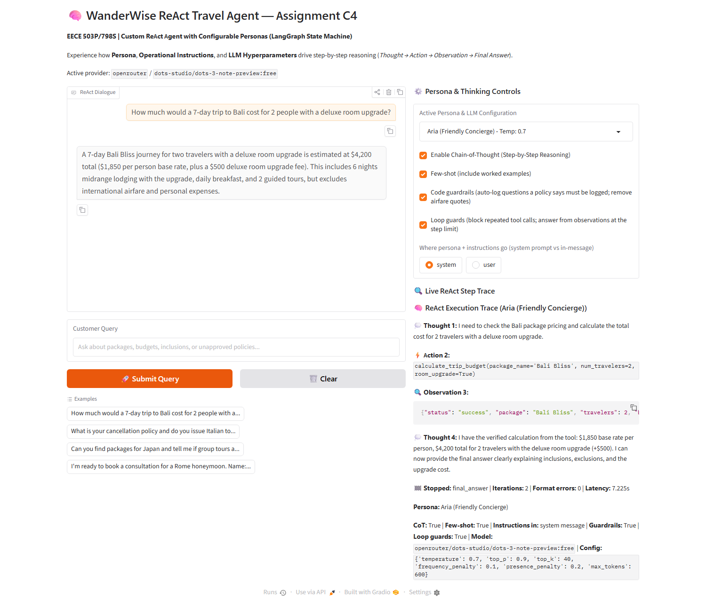
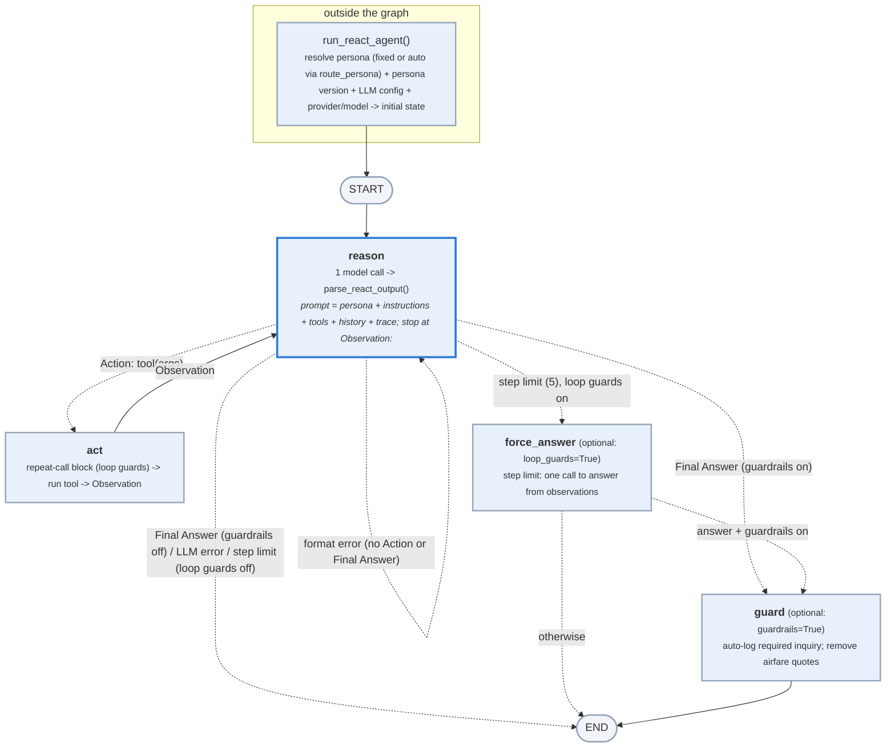

# WanderWise ReAct Travel Agent with Configurable Personas
**Course:** EECE 503P/798S: Agentic Systems  
**Assignment C4:** Build a Custom ReAct Agent with Configurable Personas  
**Framework:** LangGraph (State Machine Workflows)

---

## Key findings

From 497 error-free logged and automatically scored runs on 9 models (details in section 6 of [`c4_react_agent.ipynb`](c4_react_agent.ipynb)):

1. **The model mattered more than anything else.** With identical settings (3 personas × 6 test cases): `dots-3-note-preview` and `nemotron-3.5-super-vl` 18/18, OpenAI `gpt-4o-mini` and `nemotron-3-super-120b` 17/18, Claude Haiku 4.5 16/18, `xing4.0` 14/18, `laguna-s-2.1` 13/18. *(§6.5)*
2. **The personas have similar correctness but differ in voice and failure mode.** Aria 39/42, Marcus 36/42, Elena 38/42. Marcus answers in about 58 words; Aria and Elena use about 91. Only the warm personas invented airfares (with the original v1 wording: Aria 6/33 answers, Elena 4/13, Marcus 0/27). *(§6.6)*
3. **Fixing the persona/instruction conflict worked.** One boundary sentence (persona v2) cut invented airfares on Haiku from 4/10 to 0/10. *(§6.9)*
4. **Prompting effects depend on the model.** Chain-of-thought plus few-shot examples prevented loops on xing4.0 (12/12 vs 12/18, one-sided Fisher p = 0.03). On Haiku, the same setup coincided with one arithmetic error: $5,100 instead of $4,700 in 6/6 runs vs 0/9 without. Instructions in the system prompt vs the user message made no difference. *(§6.2)*
5. **No single sampling setting had a measurable effect** at 6 runs per condition. The exception is `max_tokens=120`, which shortened Haiku answers from 135 to 43 words and xing4.0 answers from 78 to 52, with no loss of correctness. *(§6.3)*
6. **The rules mostly control scope and length on a strong model.** Removing them left correctness almost unchanged (18/18 vs 16/17), but Aria's answers nearly doubled in length, and the only invented airfare in that test appeared without the rules. *(§6.7)*
7. **The safety nets work, with honest limits.** Loop guards rescued 1 of 3 looping runs on xing4.0. Optional guardrails auto-log required questions and remove airfare quotes. *(§6.8, §5)*
8. **The persona voices are recognisable, but unevenly.** A blind LLM judge identified the right persona in 70/121 answers (57.9%; chance 33.3%). On the same 117 answers with a length baseline, the judge scored 57.3% versus 49.6% for length. Marcus is easy to spot; Elena is often taken for Marcus, and the v2 boundary weakened her voice further. *(§6.12)*

### The app in action



---

Companion repository: [WanderWise-C3-Business-Agent](https://github.com/Jadjnm/WanderWise-C3-Business-Agent).

Builds on the WanderWise business assistant from Assignment C3: [WanderWise-C3-Business-Agent](https://github.com/Jadjnm/WanderWise-C3-Business-Agent)

## 1. Overview & Objectives

This project extends the **WanderWise Travel** assistant by implementing a **ReAct reasoning agent** (*Reasoning + Acting*) using **LangGraph**.

Rather than answering in a single pass, the agent moves through explicit thinking and tool-use steps:
`Thought -> Action -> Observation -> Thought -> Final Answer`

### Core Implementation
* **No Prebuilt Executors:** The ReAct cycle is implemented manually via a custom LangGraph `StateGraph` using states, nodes (`reason`, `act`), and conditional edges (`should_continue`).
* **Configurable Personas & Hyperparameter Alignment (with per-setting rationales and assigned tasks):**
  1. **Aria (Friendly Concierge):** *Task:* First contact, general questions and leads. Warm, welcoming, encouraging, empathetic, and conversational (`temp 0.7`: warm variety without factual drift; `top_p 0.9` / `top_k 40`: broad hospitable vocabulary; `freq 0.1` / `pres 0.2`: discourages repeating pleasantries and introduces fresh travel ideas; `max_tokens 600`: space for warm greetings and breakdowns).
  2. **Marcus (Budget & Policy Auditor):** *Task:* Prices, budgets and policy checks. Analytical, precise, objective, concise, and uncompromising on guardrails (`temp 0.1`: deterministic and repeatable budget/policy answers; `top_p 0.5` / `top_k 10`: high-probability token selection eliminating speculation; `freq 0.4` / `pres 0.0`: prevents boilerplate repetition and stays strictly on verified numbers; `max_tokens 400`: concise audit brevity).
  3. **Elena (Adventurous Experience Curator):** *Task:* Destination experiences and highlights. Evocative, sensory, culturally immersed, and experiential (`temp 0.85`: rich evocative sensory language; `top_p 0.95` / `top_k 64`: vibrant vocabulary for cultural immersion; `freq 0.2` / `pres 0.5`: nudges narrative forward to new sights and details rather than repeating; `max_tokens 800`: room for descriptive vignettes).
* **Demo Add-on Rates:** The deluxe room upgrade ($250 per person) and private guide ($400 flat) rates are demo values used only by the C4 budget tool; the C3 business summary lists room upgrades as unconfirmed.
* **Prompt Engineering Experiments & Instructions Ablation:** Toggles for Chain-of-Thought on/off, zero-shot vs. few-shot, system prompt vs. in-message instructions, `instructions_mode` (`full` vs `format_only` rules ablation), and `loop_guards` (repeat-action block + forced final answer at step limit), plus per-run overrides of temperature, top-p, top-k, max tokens, penalties, and model, all run and logged by `experiments.py`.
* **Persona/Instruction Conflict Analysis:** Automated `check_persona_conflicts()` scanner documenting tone instructions that pull against operational rules.
* **Dedicated Instructions Block:** Explicit input/output contracts with an embedded worked example.
* **Reflection Questions:** Complete answers to all reflection questions included in [`c4_react_agent.ipynb`](c4_react_agent.ipynb).

---

## 2. Project Files

| File | Purpose |
|---|---|
| `c4_react_agent.ipynb` | C4 notebook: manual LangGraph ReAct state machine, persona design, and experiment evaluation |
| `react_core.py` | Standalone ReAct state machine, tools, persona configurations, and guardrails for C4 |
| `c4_app.py` | Interactive Gradio application for C4 with real-time ReAct trace inspector |
| `experiments.py` | Experiment harness for C4: personas, prompting, params, models, guardrails, instructions, loop_guards, persona_v2 and auto_persona suites |
| `tests/test_react_agent.py` | Offline unit tests for C4 ReAct agent and tools (73 tests; no live API key required) |
| `tests/test_persona_judge.py` | Offline mocked persona judge tests (14 tests; no live API key required) |
| `README.md` | Documentation and experimental evaluation guide for C4 |
| `.env.example` | Template for environment variables and provider credentials |
| `requirements.txt` | Python package dependencies |
| `.gitattributes` | Git text and line-ending normalization rules |
| `.gitignore` | Git exclusions for secrets, caches and generated files |
| `docs/c4_app_screenshot.png` | C4 Gradio application screenshot |
| `docs/react_graph.svg` | Vector illustration of the C4 ReAct state graph |
| `docs/react_graph_preview.png` | Raster preview of the C4 ReAct state graph |
| `logs/c4_experiments.jsonl` | Recorded OpenRouter/OpenAI experiments with configurations, traces and metrics |
| `logs/c4_experiments_bedrock.jsonl` | Recorded Bedrock experiments with configurations, traces and metrics |
| `logs/c4_persona_judge.jsonl` | Saved blind persona judgments and length-baseline predictions for offline analysis |

---

## 3. ReAct State Machine Architecture




### Optional code guardrails & loop guards
* `run_react_agent(..., guardrails=True)` adds a `guard` node after the Final Answer: it calls `record_unanswered_inquiry` when a policy lookup said the question must be logged but the model skipped it, and removes sentences that quote an airfare price. Guardrails are off by default (all logged experiments ran without them); they are enabled by default in `c4_app.py`. Measure the effect with `python experiments.py --suite guardrails`.
* `run_react_agent(..., loop_guards=True)` adds loop prevention: (1) **Repeat-action block in `act` node:** intercepts duplicate tool calls with the exact same name and arguments earlier in the turn and returns an error observation to break repeating loops; (2) **Forced final answer in `force_answer` node:** if the 5-step limit is reached without a final answer or LLM error, makes ONE more LLM call forcing a final answer from existing observations (`stopped_reason="forced_answer"`). Loop guards default to OFF in `run_react_agent` and ON in `c4_app.py`. Measure with `python experiments.py --suite loop_guards`.
* `run_react_agent(..., instructions_mode="format_only")` (default `"full"`): drops operational rules and worked examples to evaluate instruction adherence under format-only constraints. Measure with `python experiments.py --suite instructions`.
* `check_persona_conflicts()`: scans each persona's tone instructions for phrases that pull against operational rules.

### Available Tools
1. `search_travel_packages(query: str)`: Queries destination packages (Bali, Rome, Santorini, Swiss Alps, Japan).
2. `calculate_trip_budget(package_name, num_travelers, room_upgrade, private_guide)`: Computes base rates and optional add-ons.
3. `lookup_policy_rule(topic: str)`: Audits company policies on flights, visas, cancellations, and bookings.
4. `record_customer_lead(name, email, notes)`: Saves consultation leads to `logs/c4_leads.jsonl`.
5. `record_unanswered_inquiry(question: str)`: Logs unanswerable inquiries to `logs/c4_feedback.jsonl`.

---

## 4. Running the C4 ReAct Agent

### Option A: Launch Interactive Gradio Demo
```bash
python c4_app.py
```
Open your browser at `http://127.0.0.1:7860`. You can switch personas, toggle Chain-of-Thought, toggle code guardrails and loop guards, and watch the Thought, Action, and Observation trace update in real time.

### Option B: Run the Jupyter Notebook
Open [`c4_react_agent.ipynb`](c4_react_agent.ipynb) in Jupyter or Google Colab and run all cells sequentially.

### Option C: Run the Logged Experiments
```bash
python experiments.py --list                                      # show test cases and conditions
python experiments.py --suite personas                            # 3 personas x 6 cases
python experiments.py --suite prompting --persona strict_auditor
python experiments.py --suite params --persona friendly_advisor --sleep 6
python experiments.py --suite models --models model_a,model_b --sleep 5   # every persona on every model
python experiments.py --suite guardrails                                  # personas with guardrails off vs on
python experiments.py --suite instructions --sleep 3                      # instructions ablation (full vs format_only)
python experiments.py --suite loop_guards --repeats 3 --sleep 5           # strict_auditor loop guards off vs on
python experiments.py --suite persona_v2                                  # Aria/Elena v1 vs v2
python experiments.py --suite auto_persona                                # automatic routing vs Aria
python experiments.py --suite prompting --repeats 3 --resume               # add repeats or resume after a stop
python experiments.py --rescore                                            # re-score everything, latest run per key
```
Use `--log <file>` to keep a parallel run (e.g. a second provider) in its own log.
Every run (config, full trace, raw model output, metrics) is appended to `logs/c4_experiments.jsonl` (or your `--log` file), and each invocation writes a comparison table to `logs/c4_experiments_summary_<run_id>.md`.

**Provider selection:** `LLM_PROVIDER` in `.env` is always honoured; if blank, the first real key found is used (Gemini, then OpenRouter, then OpenAI, then Bedrock). With no key, or `REACT_SIMULATE=1`, a clearly labelled offline simulator runs instead. A failed live call is reported as an error and is never replaced with simulated output.

**AWS Bedrock:** set `LLM_PROVIDER=bedrock`, plus either `AWS_BEARER_TOKEN_BEDROCK` (a Bedrock API key) or `AWS_ACCESS_KEY_ID`/`AWS_SECRET_ACCESS_KEY` or `AWS_PROFILE`, `AWS_REGION`, and `BEDROCK_MODEL_ID` (an inference-profile id such as `us.anthropic.claude-haiku-4-5-20251001-v1:0`, enabled under *Model access*). Bedrock's Converse API has no frequency/presence penalties, and newer Claude models refuse `top_p` together with `temperature`; parameters a model rejects are dropped and recorded per run under `ignored_params`. Summary tables group runs by model, so results from different providers in the same log are never mixed.

### Option D: Run Unit Tests
```bash
# Run C4 ReAct agent unit tests (73 tests)
python -m unittest tests/test_react_agent.py -v

# Run every C4 test (87 tests: 73 ReAct + 14 judge; complete published C4 suite)
python -m unittest tests.test_react_agent tests.test_persona_judge -v
```

Blind persona fidelity (notebook section 6.12): judge existing logged answers only and append resumable results to `logs/c4_persona_judge.jsonl` with `cmd /c "set OPENAI_API_KEY=&& set LLM_PROVIDER=openai&& python experiments.py --judge-personas"`; notebook tables work offline.

The combined working folder also contains the 30 C3 tests; `python -m unittest discover -s tests` runs 117 tests there.

C3 companion demo: [Watch the C3 demo video](https://mailaub-my.sharepoint.com/:v:/g/personal/jne20_mail_aub_edu/IQBS758Xsy8gSI1HMyzuLB8-AYwz8GK7bNJh5nVka8Nwctc?nav=eyJyZWZlcnJhbEluZm8iOnsicmVmZXJyYWxBcHAiOiJPbmVEcml2ZUZvckJ1c2luZXNzIiwicmVmZXJyYWxBcHBQbGF0Zm9ybSI6IldlYiIsInJlZmVycmFsTW9kZSI6InZpZXciLCJyZWZlcnJhbFZpZXciOiJNeUZpbGVzTGlua0NvcHkifX0&e=T8ofLM). [Try the app on Hugging Face Spaces](https://huggingface.co/spaces/jadjnm/wanderwise-aria).

Default models: OpenRouter `dots-studio/dots-3-note-preview:free`; Bedrock Claude Haiku 4.5 (`us.anthropic.claude-haiku-4-5-20251001-v1:0`); Gemini `gemini-3.8-flash`; OpenAI `gpt-4o-mini`.
